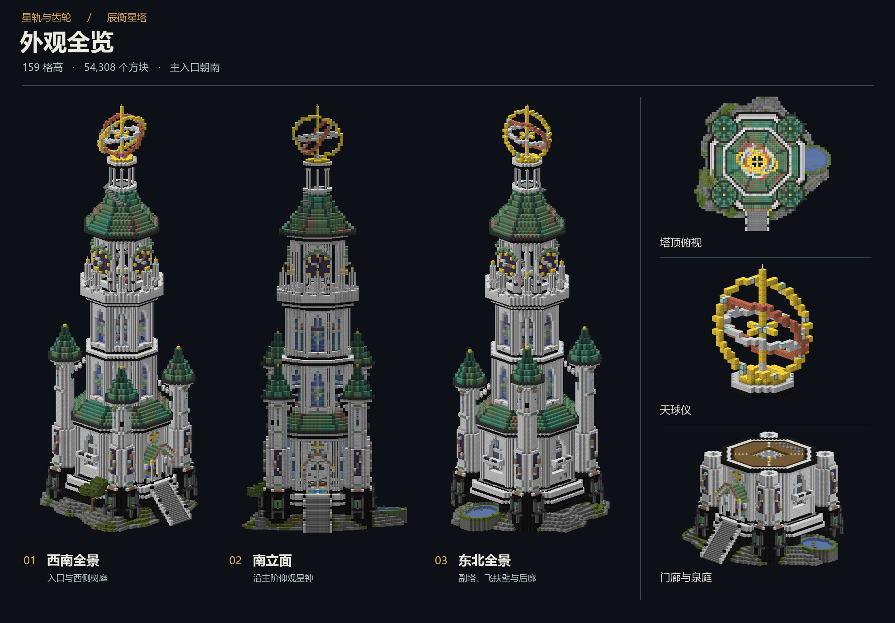
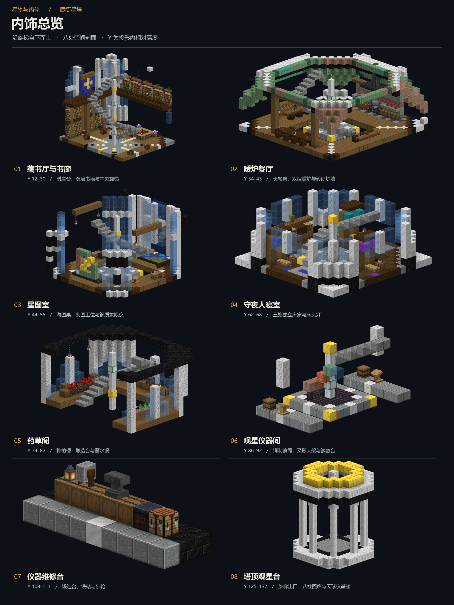

# Minecraft Schematic Editor · Agent Building Workshop

English | [简体中文](README.zh-CN.md)

Describe a Minecraft build, let an agent create it through MCP, review it in a browser, and save a local schematic.

Built on **Faraway24's MinecraftSchematicEditor**. Thank you to the original author for the schematic formats, 3D renderer, and editing tools that make this fork possible. This fork adds MCP, an agent skill, live browser editing, and multi-angle and cutaway previews. [Original project](https://github.com/Faraway24/MinecraftSchematicEditor)

## Ask an agent to set it up

Send this to an agent with local command execution and MCP support

```text
Set up https://github.com/iceriny/MinecraftSchematicEditor using docs/agent-setup.md. Install its dependencies, configure the MCP server and bundled skill, start the local webpage, and verify the connection. Give me the page URL, instructions for saving a build, and the example building prompt when setup is complete.
```

The [agent setup guide](docs/agent-setup.md) covers installation through handoff. Agents working in this checkout can start at [AGENTS.md](AGENTS.md).

## From setup to a saved build

| Stage | What to do |
| --- | --- |
| Install | Use Node.js 20.19+ or 22.12+, clone this repository, and run `npm ci` |
| Connect an agent | Configure `node <absolute-repository-path>/mcp/launch.mjs` as a stdio MCP server and install the bundled skill |
| Open the editor | On Windows, double-click `start-editor.cmd`, or run `npm run dev` in a terminal |
| Build | Describe the materials, style, dimensions, and purpose. The agent can place, replace, copy, rotate, and undo blocks |
| Review | Watch live changes in the browser, or ask for exterior views and room cutaways |
| Save | Name an output directory. The agent can export `.litematic`, `.schem`, or structure `.nbt`, along with PNG previews |
| Continue later | Start the webpage again and ask the agent to open the saved schematic |

The local editor runs at <http://127.0.0.1:5173>. See [Windows launchers](docs/windows.md) for background operation and custom Minecraft paths.

For manual setup

```sh
git clone https://github.com/iceriny/MinecraftSchematicEditor.git
cd MinecraftSchematicEditor
npm ci
npm run dev
```

Configure the [MCP connection](mcp/README.md) in your agent host separately. Live editing and screenshots use this local webpage.

## Your first building prompt

After setup, the agent gives you this template. Replace the bracketed fields, and add dimensions, room requirements, or an output directory as needed.

```text
Use [mod name] and vanilla building materials to create [building goal] in [style]. Include details, decorations, weathering, and a natural, attractive finish. You can refer to common Minecraft decoration techniques. Give it rich detail and beautiful interiors that combine practical use with good design. You can also research interior-building techniques online. Use blocks for their shapes, textures, and colors as well as their usual roles; many Minecraft interiors are assembled from combinations of blocks.
```

For example

> Build a grand observatory tower over 100 blocks tall using Astral Sorcery marble and vanilla materials. Use weathered copper roofs, star clocks, an armillary sphere, and natural aging. Include a library, chart room, bedrooms, and an herb loft. Show exterior and interior cutaways, then save the schematic to my chosen directory.

## Example · Chenheng Star Tower

Built through this project's MCP using Astral Sorcery marble and vanilla materials. The tower is 159 blocks tall and contains 54,308 blocks. These overview sheets use actual editor renders.





Download the [tower schematic](examples/chenheng-tower.litematic) and open it in the editor, or ask the agent to load it with `schematic_open`. It uses Minecraft 1.21.1 block states and the `astralsorcery` marble family. Load the matching client and mod JARs to see the pictured textures.

## Capabilities and scope

- Read Litematica, WorldEdit, and structure files. Legacy `.schematic` is read-only.
- Twelve MCP tools cover file and live editing, resources, undo, previews, and saving. [MCP guide](mcp/README.md)
- The bundled skill teaches agents mode selection, efficient calls, browser assistance, and connection handling. [Agent skill](skills/minecraft-schematic-editor/SKILL.md)
- The editing model handles blocks and block states. Files containing entity or block-entity NBT are rejected. Browser autosave keeps the active document; save a schematic for future sessions.
- Parsing and the browser bridge run locally. Textures come from your Minecraft installation or resource packs.

See the [editor reference](docs/editor-guide.md) for mouse controls, shortcuts, model rendering, and source layout.

## Checks and development

```sh
npm run check:setup
npm run check:setup -- --require-browser
npm run test:mcp
npm run typecheck
npm run build
```

`check:setup` opens a temporary MCP connection and checks tools and browser availability. An agent also verifies the host chat's own tool definitions after reconnecting. Dependencies, logs, caches, local settings, and build output are ignored by Git.

## License and acknowledgements

This fork retains the [MIT license](LICENSE) and Faraway24's copyright notice. Thank you to [Faraway24/MinecraftSchematicEditor](https://github.com/Faraway24/MinecraftSchematicEditor) for the original editor and rendering foundation. Dependencies retain their own licenses.
