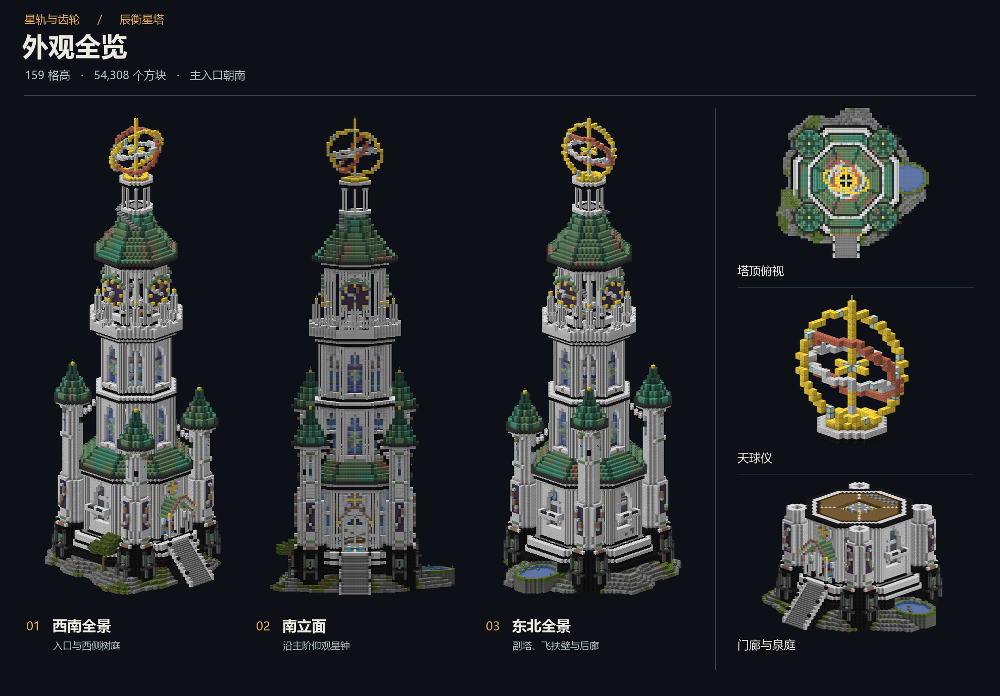
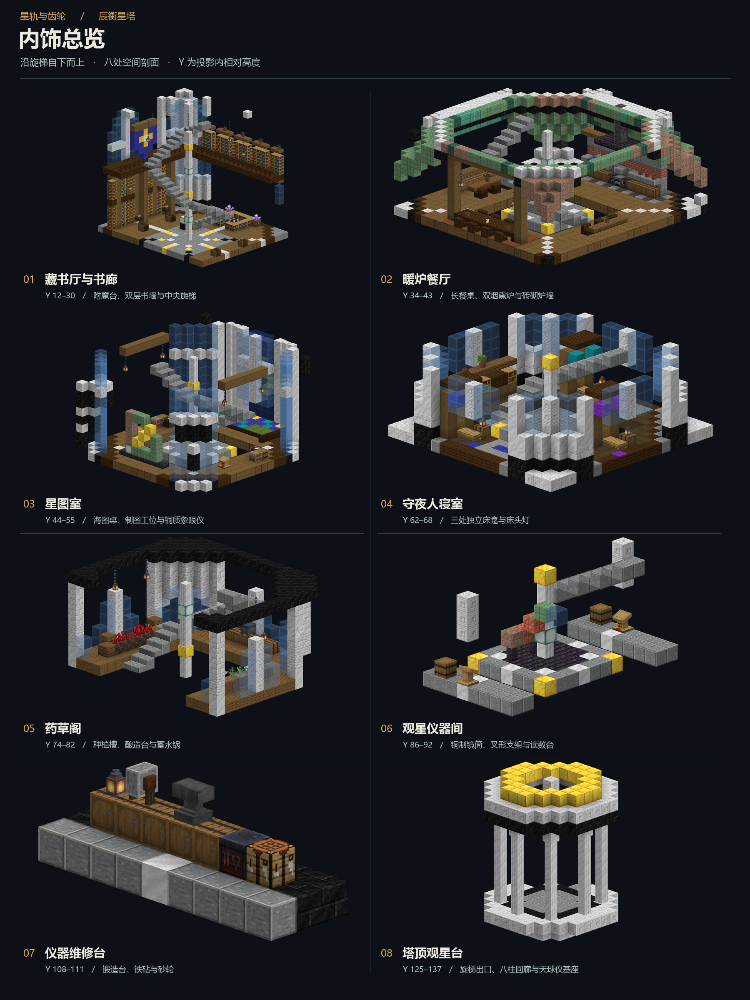

# Minecraft Schematic Editor · Agent 建筑工坊

[English](README.md) | 简体中文

用自然语言描述建筑，让 Agent 通过 MCP 制作投影，在浏览器里查看、调整，再保存到本地。

本项目基于 **Faraway24 的 MinecraftSchematicEditor**。感谢原作者提供投影读写、三维渲染和完整编辑工具。本 fork 在原项目之上加入 MCP、Agent Skill、实时网页联动和多角度／剖面预览。[原项目](https://github.com/Faraway24/MinecraftSchematicEditor)

## 一句话交给 Agent 部署

将下面这段发给支持本地命令和 MCP 的 Agent

```text
帮我部署 https://github.com/iceriny/MinecraftSchematicEditor，按仓库 docs/agent-setup.md 完成依赖安装、MCP 和 Skill 配置，启动本地网页并验证连接。完成后给我网页地址、保存文件的方法和建筑样例提示词。
```

Agent 的完整步骤见 [部署指南](docs/agent-setup.zh-CN.md)。已有仓库的 Agent 从 [AGENTS.md](AGENTS.md) 进入。

## 从启动到成品

| 环节 | 使用方式 |
| --- | --- |
| 安装 | Node.js 20.19+ 或 22.12+，克隆仓库后运行 `npm ci` |
| 配置 Agent | 将 `node <仓库绝对路径>/mcp/launch.mjs` 接到宿主 MCP，安装仓库内的 Skill |
| 启动网页 | Windows 双击 `start-editor.cmd`，或在终端运行 `npm run dev` |
| 制作 | 告诉 Agent 建筑目标、模组、风格和尺寸，它可批量放置、替换、复制、旋转和撤销 |
| 预览调整 | 网页实时观察，Agent 可直接生成多角度图和房间剖面 |
| 保存 | 指定本地目录，Agent 导出 `.litematic`、`.schem` 或结构 `.nbt`，可一并保存 PNG |
| 下次继续 | 重新启动网页，再让 Agent 打开上次保存的投影 |

网页地址为 <http://127.0.0.1:5173>。Windows 后台运行和自定义游戏路径见 [本地启停说明](docs/windows.zh-CN.md)。

手动安装并启动

```sh
git clone https://github.com/iceriny/MinecraftSchematicEditor.git
cd MinecraftSchematicEditor
npm ci
npm run dev
```

另在 Agent 宿主中配置 [MCP 服务](mcp/README.zh-CN.md)。用于截图和实时编辑的 MCP 连接依赖这个本地网页。

## 试着描述你的第一座建筑

部署完成后，Agent 会把这段模板发给你。替换方括号里的内容即可，也可以补充尺寸、用途和保存目录。

```text
[项目路径]

使用本项目制作。使用 [模组名字] 中的方块或元件，以及原版建筑材料，制作 [建筑目标]，整体采用 [风格]。

建筑要自然、美观，有丰富的细节、装饰和适度做旧。根据建筑用途安排布局、空间和动线，让整体轮廓、建筑之间的关系及周边环境相互协调。

外观与内饰都要兼顾美观和实用。可以参考网上常见的 Minecraft 建筑装饰和内饰技巧，利用不同方块的形状、材质与颜色进行组合，拼出家具、设施和装饰，不必局限于方块本身的用途。但床等功能性设施还应考虑实际可使用性，兼顾摆放、通行和操作空间。

通过本项目的 MCP 完成制作，在网页中展示，并用多角度及剖面预览检查效果、继续调整。完成后将投影和预览图保存到 [保存目录]。
```

例如

> 使用星辉魔法的大理石和原版建筑材料，制作一座超过 100 格高的宏伟观星塔。用铜绿屋顶、星钟和天球仪组织轮廓，配上自然做旧。内部安排藏书厅、制图室、寝室和药草阁。完成后给我外观和内饰剖面，并把投影保存到我指定的目录。

## 制作实例 · 辰衡星塔

星辉魔法大理石与原版材料，159 格高、54,308 个方块。由 Agent 通过本项目 MCP 制作，以下图片由编辑器实际渲染并编排。





下载 [辰衡星塔投影](examples/chenheng-tower.litematic)，在网页中打开，或让 Agent 通过 `schematic_open` 打开文件。投影使用 Minecraft 1.21.1 的方块状态与 `astralsorcery` 大理石系列。选择对应的原版材质与模组 JAR 后，可获得图中的材质表现。

## 能力与使用范围

- 原生支持 Litematica、WorldEdit 和结构文件。旧式 `.schematic` 可读，导出使用现代格式。
- Agent 有 12 个 MCP 工具，覆盖文件编辑、网页实时编辑、资源加载、撤销、截图与保存。[MCP 工具说明](mcp/README.zh-CN.md)
- Skill 给 Agent 提供模式选择、调用示例、网页操作和连接处理。[Skill](skills/minecraft-schematic-editor/SKILL.md)
- 编辑对象为方块及 blockstate，包含实体或方块实体 NBT 的文件会拒绝载入。网页自动暂存保留当前活动文档，完成后请保存投影。
- 所有文件处理与编辑桥在本机运行。材质来自用户安装的 Minecraft 或资源包。

手动编辑与快捷键见 [编辑器使用指南](docs/editor-guide.zh-CN.md)，模型与源码详解见 [上游完整手册](docs/editor-guide.md)。

## 自检与开发

```sh
npm run check:setup
npm run check:setup -- --require-browser
npm run test:mcp
npm run typecheck
npm run build
```

`check:setup` 会新建一次临时 MCP 连接，检查工具与网页状态。当前聊天的工具是否已刷新，由 Agent 另外调用新参数确认。依赖、运行日志、缓存、本机配置和构建产物由 Git 忽略。

## 许可与致谢

沿用 [MIT License](LICENSE)，保留 Faraway24 的原版权声明。感谢 [Faraway24/MinecraftSchematicEditor](https://github.com/Faraway24/MinecraftSchematicEditor) 的开源工作，原始项目构成了本工具的编辑和渲染基础。各依赖保留各自许可证。
